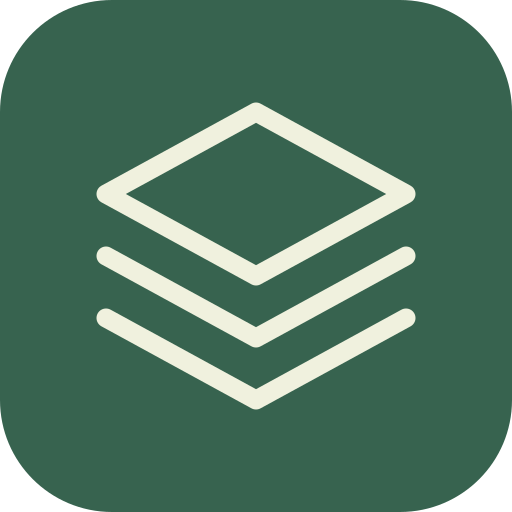

# Kasane 重ね

A macOS PostgreSQL client with SQL documents and notebooks.

- Browse schemas, tables, and views. Inspect columns, constraints, indexes, comments, and view definitions.
- Filter, sort, page through and hide columns of table data, and follow foreign keys to related rows.
- Write SQL with schema-aware completion and run it with ⌘Enter.
- Combine Markdown and SQL in notebooks with a shared session.
- Keep separate workspaces for saved connections, each with its own color and TLS mode, with passwords in macOS Keychain; test a connection before saving it.
- Jump to any table, column, document or command with ⌘K.
- Inspect whole rows, copy results as TSV, JSON or INSERT, export displayed rows as CSV, cancel queries, and switch between light and dark themes.

Kasane is in development. Table data is read-only; SQL statements can modify your database. Each execution accepts one statement, with results capped at 1,000 rows or 8 MiB. Queries are never automatically retried.

## Development

Requires macOS, Xcode Command Line Tools, stable Rust, Bun 1.4.3, and Node.js 24+. Docker is needed for the sample databases.

```sh
make setup
make dev
```

The frontend reloads as you edit; Rust changes rebuild the app. `bun run dev` runs only the frontend, without native database or file access.

Bun installs dependencies and runs project commands. Vite, Playwright, and the database fixture scripts run on Node.js.

To start a sample database:

```sh
make db-up
make db-seed
```

Connect to `127.0.0.1:55432`, database `kasane_dev`, user `kasane`, password `kasane_dev_only`, with TLS disabled. These credentials are for the local fixture only.

```sh
make db-reset      # Recreate and seed the sample database
make db-down       # Stop it and keep the data
make db-destroy    # Remove the sample databases and their volumes
```

## Testing and builds

With the sample database running and seeded:

```sh
bun run playwright install chromium webkit
make check
make build
```

`make check` runs the frontend build, Rust checks, and integration tests. `make build` creates an unsigned development app at `src-tauri/target/debug/bundle/macos/Kasane.app`.

Built with Tauri, Rust, React, TypeScript, shadcn/ui (Base UI), Tailwind, CodeMirror, and TanStack Table/Virtual.

See [database fixtures](dev/db/README.md), [architecture](docs/architecture.md), [testing](docs/validation.md), and [third-party notices](THIRD_PARTY_NOTICES.md).
